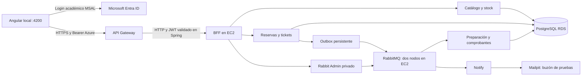

# CampusLab — Experiencia 2

Plataforma de reserva de laboratorios y equipos académicos. Java 21 / Spring Boot, Angular con MSAL, Microsoft Entra ID, API Gateway, EC2, PostgreSQL RDS y RabbitMQ.

## Componentes

| Componente | Repositorio / ubicación |
|---|---|
| Angular local, puerto 4200 | [frontend-campuslab](https://github.com/Unluccky/frontend-campuslab) |
| BFF académico | [campuslab_bff](https://github.com/Unluccky/campuslab_bff) |
| Catálogo y stock | [CampusLab-Catalog](https://github.com/se-santander/CampusLab-Catalog) |
| Reservas, tickets, comprobantes y outbox | [CampusLab-Bookings](https://github.com/se-santander/CampusLab-Bookings) |
| Consumidor de correo | [campuslab_notify](https://github.com/Unluccky/campuslab_notify) |
| API de administración RabbitMQ | [campuslab_rabbit_admin](https://github.com/Unluccky/campuslab_rabbit_admin) |

La implementación está publicada en `main` de los siete repositorios, incluida esta documentación. La rama `feature/siguiente-experiencia` se conserva como referencia del desarrollo. Los nuevos registros de verificación pueden existir localmente antes de su siguiente publicación.

## Arquitectura actual

La profesora permite Angular local. Azure se usa para identidad; backend, mensajería y base de datos se ejecutan en AWS. La integración pública Gateway–EC2 usa HTTP; Spring vuelve a validar JWT. El panel RabbitMQ y Mailpit se enlazan solo a localhost de su instancia. Rabbit Admin recibe acceso privado desde la instancia de aplicaciones.

## Flujo demostrado

Solicitud → aprobación → preparación → uso → devolución. La aprobación retiene una unidad de stock y devolución/cancelación la libera. Los comandos persistidos en outbox generan correos, tickets de preparación y comprobantes PDF mediante RabbitMQ. El técnico puede responder los tickets. Estudiantes consultan sus propias reservas; Admin/Operador gestionan el dominio. La administración RabbitMQ exige Admin.

El 19/10/2026 se verificó desde Angular la reserva #6, stock 10→9→10, ticket y respuesta, descarga de ambos PDF y creación/consulta de recursos RabbitMQ. También se verificaron deduplicación de correo y envío de un mensaje inválido a DLQ en AWS. Son evidencias de esa fecha, no un monitor de disponibilidad.

## Operación y evidencia

- [Verificación de integración y límites](infra/ep2/VERIFICACION-20261019.md).
- [Tres DLQ, eliminación desde Angular y configuración técnica: 22/10](infra/ep2/VERIFICACION-20261022.md).
- [Configuración de servicios EC2](infra/ep2/apps-compose.yml).
- [Servicios de mensajería en EC2](infra/ep2/mq-services.yml).
- [Clúster RabbitMQ](infra/mq/compose.yml).
- [Actualizar IP del Gateway al iniciar AWS Academy](infra/ep2/refresh-gateway.ps1).
- [Guía de demostración](docs/DEMOSTRACION-EP2.md).
- [Matriz de rúbrica](docs/RUBRICA-EP2.md).
- [Comparación EP3, EP4 y proyecto](docs/COMPARACION-EP3-EP4.md).
- [Entrega anterior, registro histórico](docs/EA1-estado-historico.md).

Las credenciales temporales AWS, contraseñas de BD/Rabbit/SMTP y cookies Erlang se inyectan por entorno o SSM. No se incluyen `.env`, claves privadas ni credenciales en Git. No terminar instancias ni borrar volúmenes para detener un laboratorio que debe conservar datos.

## Límites y pendientes visibles

Correo capturado en Mailpit; no se certifica entrega externa. Colas classic durables sin replicación de mensajes: dos nodos no equivalen a alta disponibilidad. La operación HTTP de stock es idempotente, pero una falla entre el commit de catálogo y el de reservas necesita reconciliación; no existe transacción distribuida.

Las tres DLQ y la eliminación de recursos desde Angular se verificaron en AWS el 22/10. La invitación técnica está aceptada y el rol configurado; falta probar su sesión real por disponibilidad del compañero. El usuario confirmó la prueba del estudiante el 22/10; falta verificar colaboradores docentes. No se atribuyen commits a otra persona ni se afirma participación que Git no demuestre. Kafka y reportería del caso semestral se mantienen como alcance posterior salvo indicación docente.
