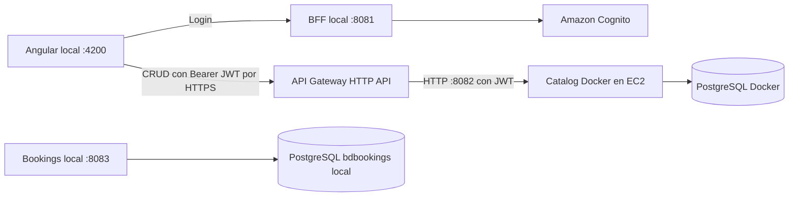
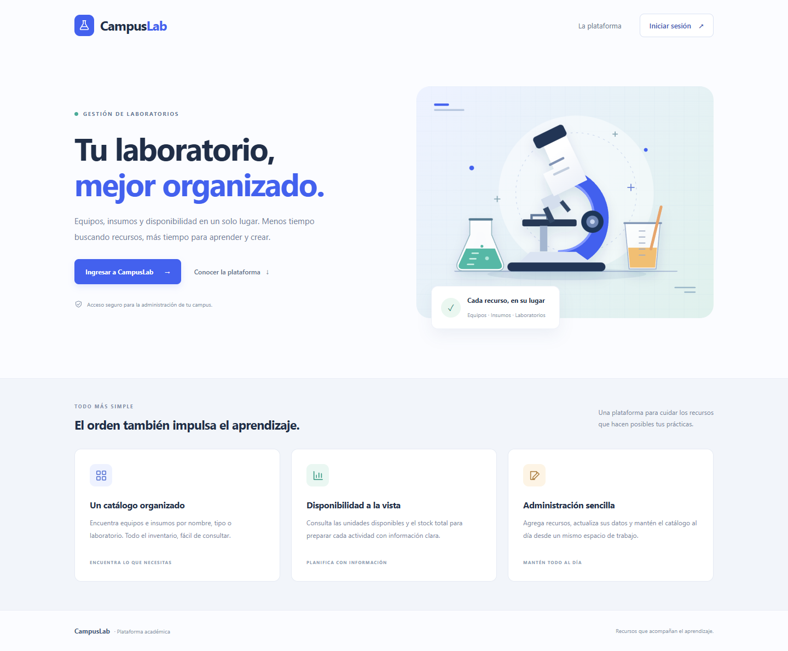
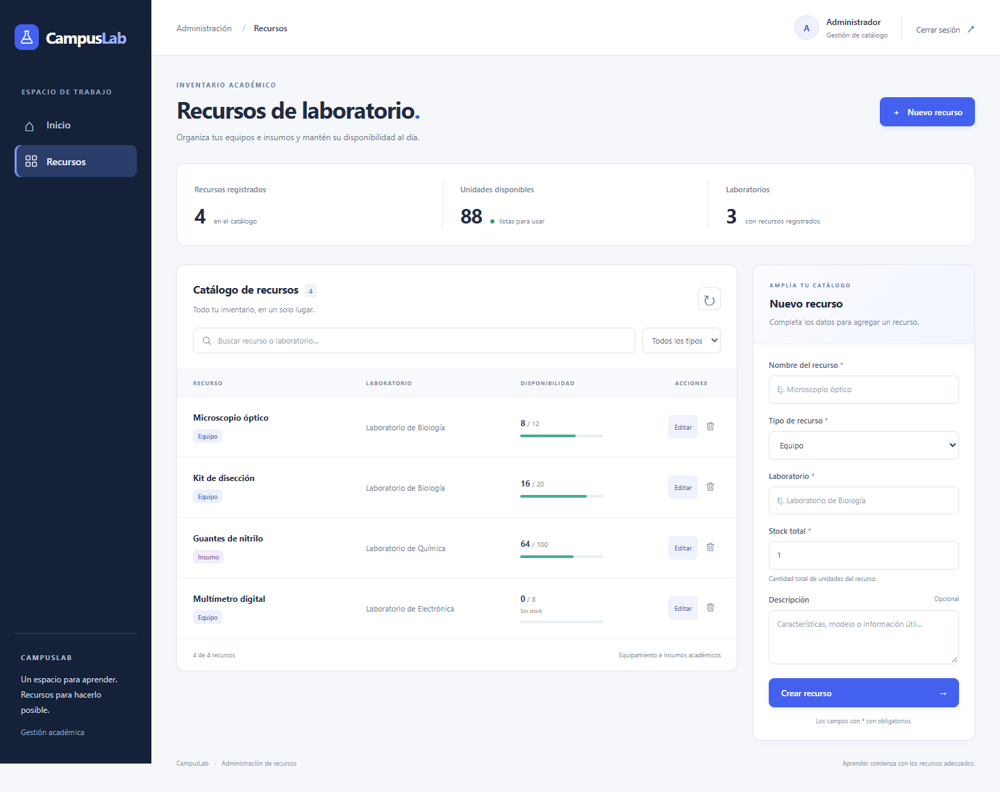

# CampusLab — documentación EA1

Plataforma académica de gestión de recursos de laboratorio. Caso semestral de **Iniciando Cloud Native I**, Duoc UC, profesora Viviana Poblete. Adaptación del caso Pedidos360 al dominio de laboratorios.

## Repositorios

| Componente | Repositorio |
|---|---|
| Frontend Angular | [frontend-campuslab](https://github.com/Unluccky/frontend-campuslab) |
| BFF y login Cognito | [campuslab_bff](https://github.com/Unluccky/campuslab_bff) |
| Catálogo | [CampusLab-Catalog](https://github.com/se-santander/CampusLab-Catalog) |
| Reservas | [CampusLab-Bookings](https://github.com/se-santander/CampusLab-Bookings) |

## Arquitectura demostrable

El catálogo se ejecuta en EC2 con Docker Compose. La base PostgreSQL no publica 5432; sus datos se conservan en un volumen. API Gateway valida el token Cognito y Spring Security en catalog exige `ROLE_ADMIN`. BFF y Angular siguen locales. La conexión de API Gateway a EC2 usa HTTP; HTTPS está en la entrada pública de API Gateway.

## Documentos y operación

- [Requisitos y cuatro diagramas](docs/EA1-requisitos-y-diagramas.md).
- [Despliegue, configuración y comandos de encendido/apagado](infra/aws/README.md).
- [Compose de EC2](infra/aws/compose.yml).
- [Identificadores del despliegue](infra/aws/deployment.json).
- [Comprobaciones HTTP y observación de la base cloud](infra/aws/verification.json).
- [Estado de los contenedores al verificar](infra/aws/containers.txt).

Salud del servicio: [API Gateway /actuator/health](https://pludtc2ix3.execute-api.us-east-1.amazonaws.com/actuator/health). La disponibilidad depende del estado de EC2 y del Learner Lab; las evidencias guardadas corresponden al momento de la comprobación, no a un monitor permanente.

## Interfaz

Home y Admin tienen diseño adaptable a escritorio y celular. Las capturas de Admin usan **datos simulados para revisión visual**, no son evidencia de registros reales en AWS.

Versiones móviles: [Home](docs/capturas/home-mobile.png) · [Admin](docs/capturas/admin-mobile.png).

## Validación y pendientes

- Login real Cognito probado por el usuario.
- Catálogo: cinco pruebas backend aprobadas; pruebas HTTP con decodificación JWT simulada y PostgreSQL real.
- Frontend: compilación y nueve pruebas específicas aprobadas; no se presenta la suite completa como validada.
- AWS: dos contenedores saludables, health 200, rechazo de token ausente/inválido 401, preflight Angular 204.
- Se observó el recurso `Prueba AWS` en PostgreSQL cloud. La eliminación cloud individual queda pendiente de confirmación.
- Reservas conserva implementación local; no tiene autenticación JWT ni coordinación de stock con catalog todavía.
- Dockerfiles de BFF y reservas disponibles; su ejecución en contenedores no fue verificada en esta sesión.
- Presentación final por armar con los cuatro diagramas (máximo 10 minutos).
- Reportería requiere aclarar su alcance en EA1, porque la pauta solo excluye explícitamente notificaciones y auditoría.
- La invitación a la profesora y la participación individual del equipo deben acreditarse en GitHub. No se inventan autores, commits ni evidencias de participación.

## Credenciales y presupuesto

Las claves temporales de AWS Academy se obtienen en AWS Details y se proporcionan mediante variables de entorno. La contraseña de PostgreSQL también se entrega por entorno. Ninguna contraseña, clave privada SSH ni archivo `.env` forma parte de este repositorio.

Para detener EC2 y conservar los datos, seguir la guía de operación. El volumen sigue teniendo costo mientras exista. No terminar la instancia ni borrar volúmenes si se necesita preservar la información.

Actualización de validación: las pruebas de contexto de BFF y reservas también pasaron el 22/09/2026 (una por servicio). Reservas conectó con PostgreSQL local durante la prueba.
