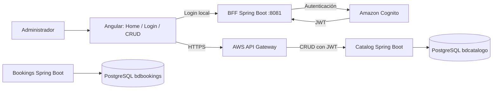
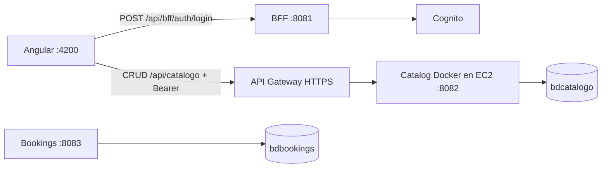
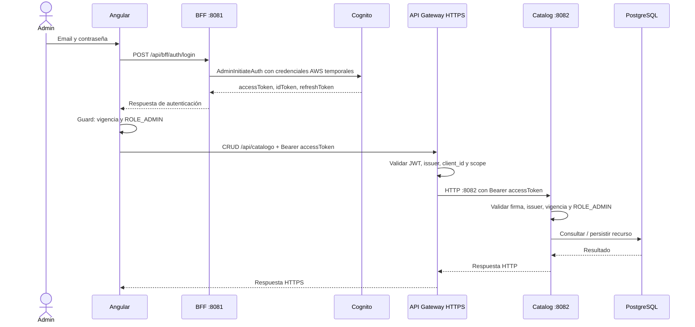
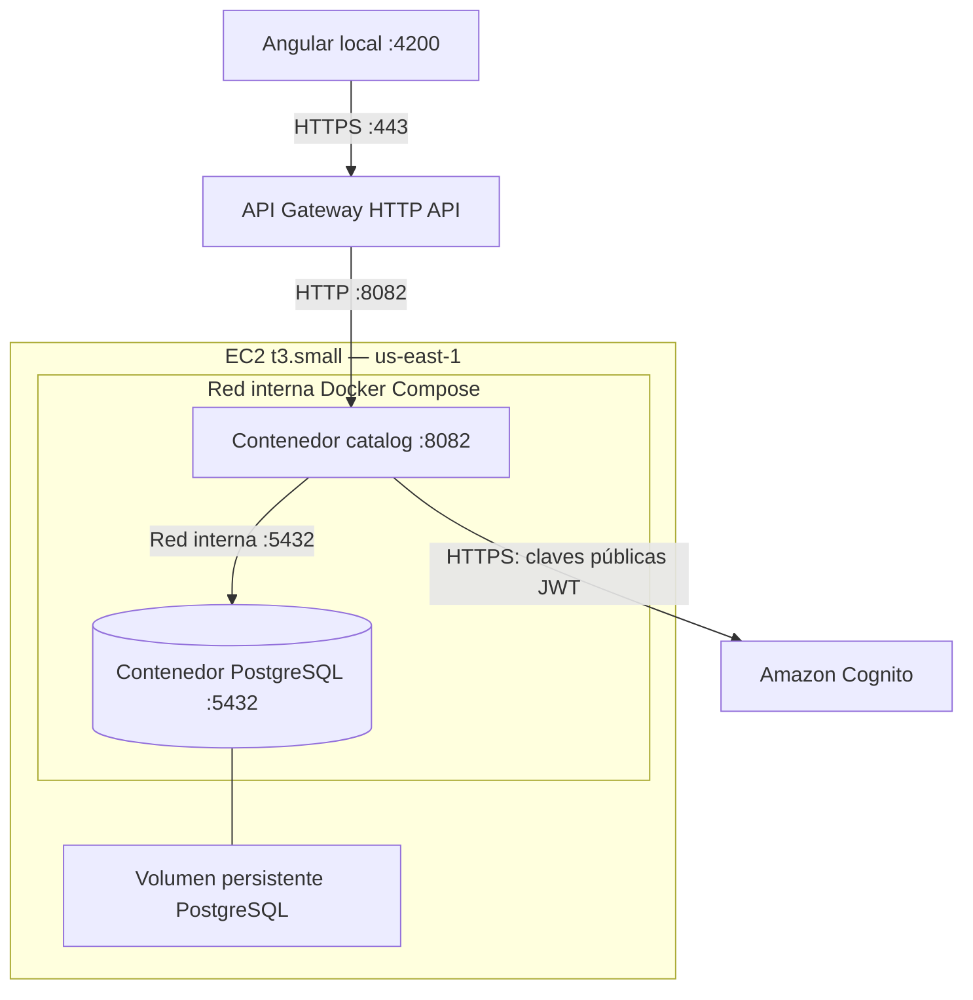

# CampusLab — revisión de alcance EA1

Fuente principal: REQUERIMIENTOS ENTREGA EXPERIENCIA 1.pdf, páginas 1–2. El caso CampusLab define el dominio; las guías AWS muestran procedimientos de referencia.

## Requisitos confirmados

- Spring Boot, base de datos elegida por el equipo y Docker por microservicio.
- Al menos un servicio desplegado en EC2 y rutas cloud en API Gateway.
- PostgreSQL puede correr en la misma EC2; RDS es una alternativa, no una obligación.
- Autenticación Admin con Cognito o Entra ID.
- Angular: Home, Login y un CRUD Admin funcional; validaciones, CSS, responsividad y guard.
- Registro y recuperación de contraseña se solicitan visualmente en esta etapa.
- Cuatro diagramas y exposición de máximo 10 minutos.
- Todos los equipos envían el 22 de septiembre.
- GitHub queda fuera del trabajo actual por indicación del usuario; no se verificaron colaboradores ni participación.

## Punto de alcance pendiente de aclaración

La pauta excluye notificaciones y auditoría, pero no excluye reportería expresamente. El caso semestral incluye report. El resumen inicial del equipo indica mínimo dos microservicios: no se debe afirmar que ese mínimo está escrito en la pauta adjunta.

## Estado comprobado en esta sesión

- Angular compila y sirve en localhost:4200.
- Home rediseñado con navegación, acceso al login, ilustración SVG local de laboratorio y secciones sobre catálogo, disponibilidad y administración. Comprobado en escritorio y celular, sin desbordamiento horizontal; enlace de ingreso y compilación correctos.
- BFF compila y su health responde 200 en 8081.
- Catalog compila, conecta con PostgreSQL y su health responde 200 en 8082.
- Catalog exige JWT y ROLE_ADMIN; sin token responde 401. Preflight CORS desde Angular responde 200.
- Angular llama al BFF local para login y a API Gateway para el CRUD cloud. Ambos archivos de entorno ya usan la URL de AWS y Angular compila.
- Login real y carga del catálogo autenticado: confirmados por el usuario. El usuario también confirma cambios en el CRUD; las operaciones individuales están cubiertas por pruebas automatizadas.
- CRUD: 5 pruebas backend aprobadas (incluido arranque), con PostgreSQL real y JWT simulado en las pruebas HTTP; rollback por prueba. Se comprueban creación, consulta, edición, eliminación lógica, stock ocupado, validación y autorización.
- Frontend: 9 pruebas específicas aprobadas para autenticación, servicio de recursos y componente Admin. No representan la suite completa de Angular.
- Admin rediseñado: navegación lateral, resumen calculado del inventario, búsqueda por nombre/laboratorio, filtro por tipo, formulario con mensajes y tabla adaptable a celular. Compilación y 9 pruebas aprobadas; revisión visual en Chrome a 1440 y 390 px con datos simulados, sin errores del navegador ni desbordamiento horizontal.
- Correcciones activas: listar solo recursos activos; ajustar stock disponible al editar el total; rechazar total inferior a unidades ocupadas; validar campos; evitar envíos duplicados.
- AWS EC2/API Gateway: desplegado en us-east-1; instancia i-0e59dc1bacbdc9483 y HTTP API pludtc2ix3. Ambos contenedores saludables; health 200 UP por API Gateway, sin token 401 y CORS 204. Evidencias en infra/aws.
- Bookings: compilación y prueba de contexto con PostgreSQL local aprobadas (1 prueba). No se ha comprobado su ejecución en Docker ni todos sus endpoints.

## 1. Arquitectura EA1 desplegada

Angular y BFF se ejecutan localmente; el CRUD cloud atraviesa API Gateway hacia catalog en EC2. El BFF también ofrece consultas hacia el catálogo local. La centralización de todo el CRUD en el BFF del caso semestral requiere ampliar sus endpoints.

## 2. Arquitectura de microservicios actual

Catalog gestiona recursos y stock. Bookings permanece local y gestiona reservas y estados. BFF autentica contra Cognito. No se ha verificado una integración de reservas con stock.

## 3. Secuencia JWT del flujo con AWS

El guard controla navegación; API Gateway verifica el token y el backend comprueba ROLE_ADMIN. El login sigue usando el BFF local. No mostrar claves AWS ni tokens en la exposición.

## 4. Despliegue AWS/Docker

Catalog y PostgreSQL en EC2, con 5432 sin publicación, volumen persistente y contraseña por variable de entorno. BFF y Angular permanecen locales. La URL de API Gateway es https://pludtc2ix3.execute-api.us-east-1.amazonaws.com; los identificadores y comandos operativos están en infra/aws/deployment.json e infra/aws/README.md.
