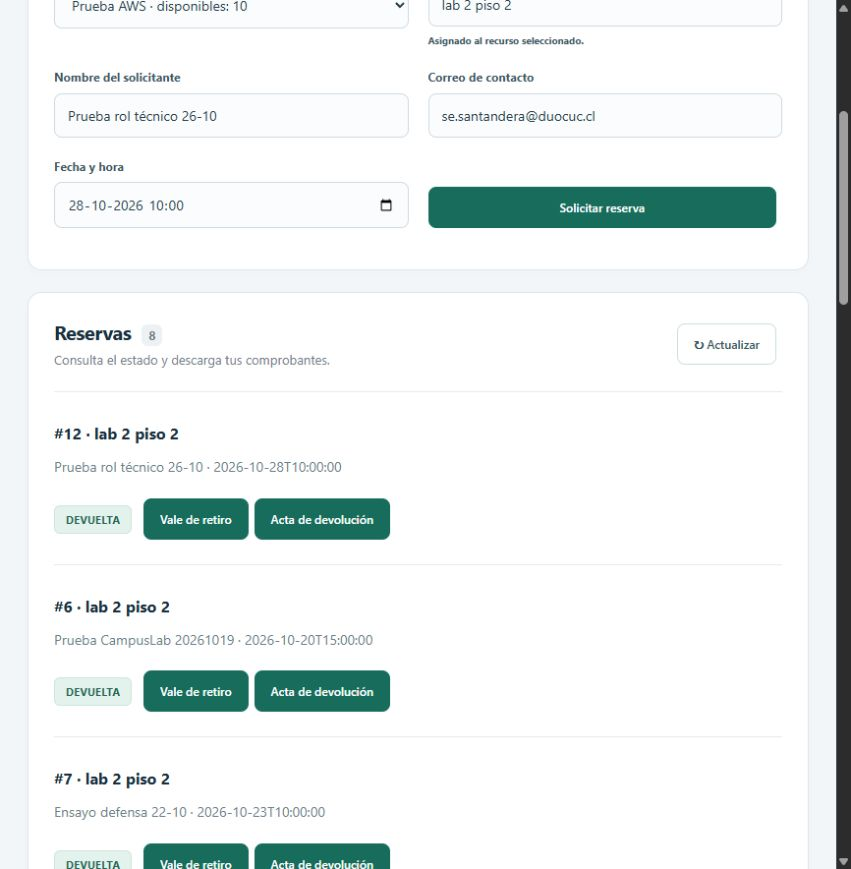

# Prueba de sesión técnica real

Fecha local: 26/10/2026 (America/Santiago).

El usuario inició sesión con Sebastián Santander Aravena. CampusLab mostró
`se.santandera@duocuc.cl`, roles Estudiante y Técnico, e identidad y permisos
verificados por el servidor. La navegación no mostró administración de mensajería.

Se ejecutó desde Angular, con esa sesión, una reserva nueva identificada como
`Prueba rol técnico 26-10`, sin modificar reservas anteriores:

- Reserva #12, recurso Prueba AWS, laboratorio `lab 2 piso 2`, fecha 28/10/2026 10:00.
- Solicitud creada y aprobación aceptada por el backend.
- Stock observado: 10 antes de aprobar, 9 después de aprobar.
- Transición a EN_PREPARACION y generación del ticket #12.
- Respuesta guardada: `Prueba del rol técnico: equipo revisado y laboratorio preparado por Sebastián.`
- Ticket mostrado como RESPONDIDO.
- Transiciones a EN_USO y DEVUELTA aceptadas.
- Stock final: 10.
- Interfaz mostró botones Vale de retiro y Acta de devolución para #12.

Esta prueba cierra el pendiente de sesión técnica real registrado el 22/10.
La presencia de los botones PDF no equivale a una nueva validación del contenido
de ambos documentos. No se repitieron las pruebas de DLQ ni de rechazo HTTP 403.

Comprobaciones previas de esta sesión: EC2 de aplicaciones y mensajería activas,
RDS disponible, cuatro endpoints de salud con HTTP 200, dos nodos RabbitMQ sin
alarmas y un consumidor en cada cola principal. API Gateway se actualizó a la
IP pública actual de aplicaciones (100.53.191.190). Angular respondió HTTP 200.

## Captura del resultado

